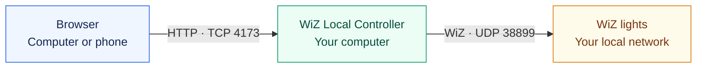

<div align="center">

# 💡 WiZ Local Controller

**Your lights. Your network. Your control.**

Discover and control WiZ lights from a private web app running on your computer.


No cloud account · No internet API · No third-party packages

[Quick start](#-quick-start) · [LAN access](#-access-from-another-device) · [Settings](#-configuration) · [Troubleshooting](#-troubleshooting)

</div>

---

## ✨ At a glance

| Discover | Control | Keep it local |
| :--- | :--- | :--- |
| Scan your private network for WiZ lights. | Add the lights you choose to your dashboard. | Commands go directly from your computer to your lamps. |

## 📋 Before you start

- [Node.js 18 or newer](https://nodejs.org/)
- A computer on the same Wi-Fi or wired network as your WiZ lights
- WiZ lights already connected to your local network

## 🚀 Quick start

### 1 · Get the app

Download this repository as a ZIP from GitHub and extract it, or clone it:

```bash
git clone https://github.com/S1M40/wiz-local-controller.git
cd wiz-local-controller
```


### 2 · Start the controller

```bash
npm start
```

**No `npm install` is required.**

### 3 · Open your dashboard

Open **<http://127.0.0.1:4173>** in a browser on the computer running the app.

### 4 · Discover your lights

Select **Discover** → enter your network range, usually `192.168.1.0/24` → scan → choose **Add** for each light you want on your dashboard.

Dashboard light names and addresses are saved locally in `data/devices.json`.

---

## 🌐 Access from another device

The default mode is **this computer only**. To open the app from a phone or another LAN client:

```bash
npm run start:lan
```

Use the address printed in the terminal, such as **`http://192.168.1.25:4173`**. Your phone can use that address while connected to the same Wi-Fi.

| Mode | Start command | Browser access |
| :--- | :--- | :--- |
| **Local — default** | `npm start` | Only the computer running the app |
| **LAN — opt-in** | `npm run start:lan` | Clients that can reach the computer through your network and firewall rules |

If Windows or another firewall asks, allow Node.js on **private networks**. If the page does not open, allow inbound **TCP port `4173`** from your local network.

> [!WARNING]
> **LAN mode has no sign-in screen.** Anyone who can reach the app can control its saved lights. Use a trusted network, apply your own firewall rules, or set the optional access restrictions below.

## 🔌 How it works



- **Discovery:** WiZ requests go only to the private subnet you enter (`/24` or smaller).
- **Control:** commands go directly to each light over UDP port `38899`.
- **Privacy:** the app itself makes no internet requests and needs no WiZ account.

> [!IMPORTANT]
> **Local control does not block a lamp's internet access.** WiZ lights may still connect to the internet independently. To keep them offline, block their WAN access in your router while allowing LAN communication with the controller.

> [!TIP]
> Give each light a **DHCP reservation** in your router for a reliable, stable IP address.

---

## ⚙️ Configuration

**No configuration is needed to get started.** For a fixed port, a specific listening address, or access restrictions, copy `config.example.json` to `config.json` and edit it:

```json
{
  "bind": "local",
  "port": 4173,
  "allowedHosts": [],
  "allowedClients": []
}
```

| Setting | Default | What it does |
| :--- | :--- | :--- |
| `bind` | `"local"` | Use `local` for this computer only, `lan` for all local network interfaces, or this computer's IPv4 address. |
| `port` | `4173` | Sets the web app's listening port. |
| `allowedHosts` | `[]` | Adds extra hostnames allowed to open the app in LAN mode. |
| `allowedClients` | `[]` | Restricts access to listed client IP addresses. Empty means no client-IP restriction; your network and firewall determine reachability. |

### Command-line examples

**LAN access on a different port**

```bash
node server.js --lan --port=8080
```

**Listen on a specific address**

```bash
node server.js --bind=192.168.1.25
```

**Restrict access to two clients**

```bash
node server.js --lan --allowed-clients=192.168.1.40,192.168.1.41
```

**Settings priority:** command-line flags → environment variables → `config.json`.

## 🛠️ Troubleshooting

| Problem | What to check |
| :--- | :--- |
| **No lights found** | Confirm the computer and lights use the same LAN/VLAN, enter the correct subnet, and disable Wi-Fi client isolation. |
| **Another device cannot open the page** | Use `npm run start:lan`, open the terminal's printed address, and allow TCP `4173` through the computer's private-network firewall. |
| **A light stopped responding** | Scan again. If its IP changed, the app asks before updating the saved address. |
| **Port already in use** | Choose another port with `node server.js --port=8080`. |

## 🧪 Development check

```bash
npm run check
```

---

## 📄 License

<details>
<summary><strong>MIT License — view full text</strong></summary>

This project is open source under the MIT License.

Copyright (c) 2026 WiZ Local Controller contributors

Permission is hereby granted, free of charge, to any person obtaining a copy of this software and associated documentation files (the “Software”), to deal in the Software without restriction, including without limitation the rights to use, copy, modify, merge, publish, distribute, sublicense, and/or sell copies of the Software, and to permit persons to whom the Software is furnished to do so, subject to the following conditions:

The above copyright notice and this permission notice shall be included in all copies or substantial portions of the Software.

THE SOFTWARE IS PROVIDED “AS IS”, WITHOUT WARRANTY OF ANY KIND, EXPRESS OR IMPLIED, INCLUDING BUT NOT LIMITED TO THE WARRANTIES OF MERCHANTABILITY, FITNESS FOR A PARTICULAR PURPOSE AND NONINFRINGEMENT. IN NO EVENT SHALL THE AUTHORS OR COPYRIGHT HOLDERS BE LIABLE FOR ANY CLAIM, DAMAGES OR OTHER LIABILITY, WHETHER IN AN ACTION OF CONTRACT, TORT OR OTHERWISE, ARISING FROM, OUT OF OR IN CONNECTION WITH THE SOFTWARE OR THE USE OR OTHER DEALINGS IN THE SOFTWARE.

</details>
